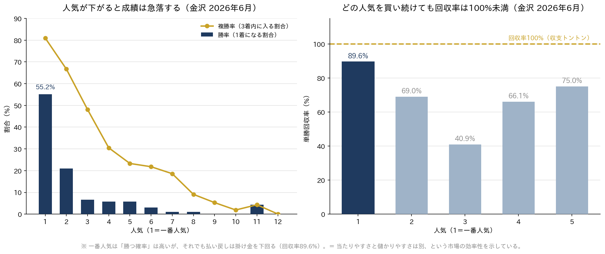
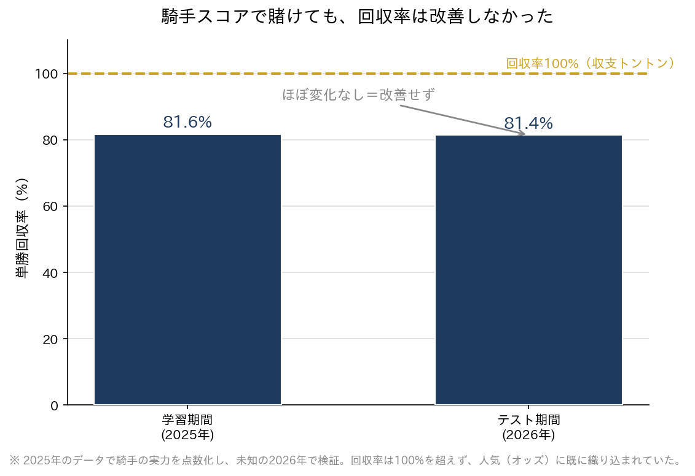

# 地方競馬（金沢）予測モデル・回収率検証プロジェクト

地方競馬（金沢競馬）の公式データ約1年分を用いて、「勝ち馬を予測し、実際に馬券として利益が出るか（回収率）」を検証したデータ分析プロジェクトです。

予測精度そのものよりも、**恣意的でない誠実な検証**を重視しました。有望に見えた仮説を、アウトオブサンプル検証（学習期間とテスト期間の分離）や年次・会場をまたいだクロスバリデーションで一つずつ確かめ、「本物のシグナルか、それとも偶然か」を見極めることを主眼としています。

> **免責事項**
> 本リポジトリは、データ分析・機械学習の学習および技術検証を目的とした個人プロジェクトです。
> 投資助言・馬券購入の推奨・的中や利益の保証を行うものではありません。
> 掲載した結果はむしろ「単純な手法で市場を上回るのは難しい」という結論を示しています。
> 内容の利用によって生じたいかなる損害についても、作者は責任を負いません。

---

## 使用技術

- **言語 / ライブラリ**: Python, pandas, scikit-learn
- **データ取得**: keiba.go.jp（地方競馬全国協会・公式）の無料公開データ（CSV / `pd.read_html`）
- **バージョン管理**: Git / GitHub（複数PC間の同期・履歴管理）
- **開発環境**: VS Code

## データ

- **対象**: 金沢競馬 2025年7月〜2026年6月（約10開催月・のべ 8,827 頭）
  - ※ 冬期休催（1〜2月）は開催が無いため除外
- **内容**: 出走馬・騎手・馬体重（増減）・着順・人気・払戻金・単勝オッズ 等
- 取得済みのデータは全国15場（ばんえいの帯広を含む）。主な分析は金沢。会場クロスチェックでは全場、全場での再検証（後述）ではばんえいを除く14場を使用。
  - ばんえい競馬は、距離200mの直線で他場とレースの性質が大きく違うため、再検証から除外。
  - 姫路は2026年1〜3月分のみで、2025年のデータがありません。
- 取得後は、開催日数・1レース平均頭数を用いた「データの健康診断」で欠損・異常を確認。

**データ出所について**
本プロジェクトで使用したのは、地方競馬全国協会の公式サイト（[keiba.go.jp](https://www.keiba.go.jp/)）で一般公開されているレース結果データです。人手による閲覧の範囲で取得し、分析用途に加工しています。個人情報や馬券の購入履歴等は一切含まれていません。

## 分析と検証結果

### 検証結果のハイライト（図）

**① 人気は当たるが、それでも儲からない**



一番人気は勝率55%と堅いものの、買い続けても単勝回収率は89.6%どまりで、収支トントンの100%に届きません。「当たりやすさ」と「儲かりやすさ」は別物であり、オッズ（＝みんなの予想）が非常に優秀であることを示しています。

**② 騎手を点数化しても、回収率は改善しなかった**



過去データ（2025年）で騎手の実力を点数化し、未知の期間（2026年）で検証しても、回収率は81%台のまま変化なし。騎手の強さは、すでにオッズへ織り込まれていました。

### 検証一覧

| # | 検証項目 | 主な結果 | 判定 |
|---|---|---|---|
| 1 | 人気の予測力 | 1番人気は勝率約51%・複勝率約83%と堅いが、3番人気以降で急落 | 人気は強い予測子 |
| 2 | 単勝回収率の基準 | どの人気帯でも回収率100%未満（1番人気でも約84%） | 勝率の高さ ≠ 利益 |
| 3 | 馬体重増減 | +10kg以上は、全期間で見ると勝率+4.9pt（11.1%→16.0%、p=0.001）。ただし回収率は53.6%と他（72.8%）より低く、差は有意でない（p=0.12） | 勝率には出るが、回収率には出ない |
| 4 | 年齢（相関 vs 因果） | 若さ自体は勝率に無関係。「体重増加馬の好走」を年齢では説明できず | 交絡ではないと確認 |
| 5 | 騎手（実力の点数化） | 2025年で学習→2026年でテスト。単勝回収率 81.6%→81.4% と改善せず | オッズに織り込み済み |
| 6 | 中穴ワイド | 全期間で82.5%だが、年分割で 74.4%(2025) / 93.9%(2026) と不安定 | 再現性なし＝偶然 |
| 7 | オッズ利用の中穴戦略 | 金沢2026で129.6%（黒字）に見えたが、全15場では黒字5場のみで散在 | ノイズと判断 |
| 8 | 予測モデル（ロジスティック回帰） | 特徴量の重みは人気が圧倒的。モデル本命の回収率80.7% vs 1番人気81.2% | 単純ベースラインを超えず |

### 全国14場（ばんえい除く）での再検証

金沢で出した上の8項目を、他の場でも成り立つかを確かめるため、同じ手順で全14場に当てました（`all_tracks_validation.py`）。判定ルールは、結果を見る前にスクリプトの冒頭へ固定しています。場ごとの数字と判定は [`results/all_tracks_report.md`](results/all_tracks_report.md) にあります。

| # | 検証項目 | 全14場での結果 |
|---|---|---|
| 1 | 人気の予測力 | 14場すべてで人気は強い予測子（1番人気の勝率は41〜51%） |
| 2 | 単勝回収率 | 14場×1〜5番人気＝70通りのうち、100%を超えたのは姫路の4番人気（111%）だけ。姫路はデータが少なく、95%区間の下限は100%未満 |
| 3 | 馬体重増減 | 10場で、+10kg以上の馬の勝率が高い（+2〜6pt）。回収率が他より有意に高かった場は無し（水沢・浦和は有意に低い） |
| 4 | 年齢 | 3で差の出た10場すべてで、年齢をそろえても差は残った |
| 5 | 騎手 | 判定できた13場すべてで、1番人気より改善せず |
| 6 | 中穴ワイド | 判定できた13場すべてで、2025年・2026年とも回収率100%未満 |
| 7 | オッズ利用の中穴戦略 | 100%を超えたのは水沢・金沢・門別・高知の4場。いずれも95%区間は100%を含み、偶然の範囲。赤字は9場 |
| 8 | 予測モデル | 判定できた13場すべてで、1番人気を超えず |

金沢の結論（単純な戦略では市場に勝てない）は、ばんえいを除く他の場でも覆りませんでした。

**この再検証の限界**
- データは約1年分で、年をまたぐ比較は「2025年下期」と「2026年上期」の2区間だけです。オッズのデータがあるのは2026年3〜6月のみ（項目7）。
- 姫路は2025年のデータが無く、項目5〜8が判定不能です（項目7は対象が15レースのみ）。
- 単勝の同着レースは、勝ち馬2頭分の払戻を拾っています。上の検証一覧（金沢）の数字は、同着レースの賭け金を二重に数えている旧スクリプトの値で、0.2〜0.6pt前後ずれる箇所があります。
- 14場×複数項目を並べているため、p値や区間で「当たり」になるものが一部は偶然でも出ます。1場だけの黒字は結論に使っていません。
- 券種（馬連・3連単など）を変えたり、戦略を足したりして同じデータで試すほど、偶然の黒字は見つかりやすくなります。新しく試すときは、条件を先に決め、試した数を記録し、今回使っていない期間（2026年7月以降のデータ）で確認する必要があります。

## 結論

複数の独立した検証（アウトオブサンプル検証・年次/会場クロスバリデーション・機械学習モデル）を通じて、一貫して次の結論に至りました。

> **市場（オッズ）は極めて効率的であり、無料の公開データから着想し得る特徴量の多くは、既に価格へ織り込まれている。単純な戦略で市場を継続的に上回ることは困難である。**

これは「勝てる必勝法が見つからなかった」という失敗ではなく、**あらゆる仮説を誠実に検証し、その限界までを客観的に見届けた**結果です。都合の良い数字を作らないことを、プロジェクト全体を通じて一貫させました。

## 本プロジェクトで実証したこと

**技術面**
- データ取得 → 前処理 → 複数月の自動統合 → 分析 → モデリングまでの一連のパイプライン構築
- ロジスティック回帰による予測モデルの構築と、アウトオブサンプルでの評価

**分析の姿勢・方法論**
- アウトオブサンプル検証／クロスバリデーションによる過学習・偶然の排除
- 相関と因果の区別、少数サンプルに対する警戒
- 「最も good に見える数字」ほど再現性を疑い、独立データで再検証する誠実さ

## ディレクトリ構成

```
keiba_app/
├── data/                     # 月別CSV（horselist / payback / racelist / odds）
├── combine_months.py         # 複数月データの自動統合
├── check_months.py           # データの健康診断
├── analyze_popularity.py     # 人気別の成績
├── analyze_roi.py            # 人気別の単勝回収率
├── analyze_weight.py         # 馬体重増減の分析
├── jockey_score.py           # 騎手の実力の点数化
├── backtest_tansho.py        # 単勝のアウトオブサンプル検証
├── backtest_wide.py          # ワイド戦略の検証
├── cross_track_check.py      # 会場クロスチェック
├── predict_model.py          # ロジスティック回帰による予測モデル
├── all_tracks_validation.py  # 全14場（ばんえい除く）での8項目の再検証
└── results/                  # 再検証の結果（all_tracks_report.md / all_tracks_results.csv）
```
